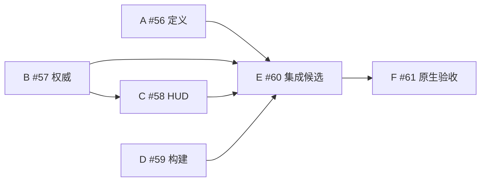

# tutorial-r2 批1 · 任务与依赖

2026-10-14｜本轮按所有者直接修复授权创建。公共合同见 [implementation-contract.md](implementation-contract.md)；原生自动化交所有者的 Codex，会话不继续调试 computer use。

| 节点 | GitHub | 文件 owner | 开始条件 / 交付 |
|---|---|---|---|
| A 定义目录与纯合同 | [#56](https://github.com/liuyejinghong/yudian-game/issues/56) | GLM-5.3；Core/Goals与两个现有纯合同项目 | 合同已固定；只读目录、合法引用/非固定计数、原数值/hash不变 |
| B 权威投影与管理门禁 | [#57](https://github.com/liuyejinghong/yudian-game/issues/57) | Sol；PlayerContracts/Main* | 合同Core API已固定，可与A分文件并行；先落地DTO供C消费，全部authority实现交E验收 |
| C 分层HUD与对象管理 | [#58](https://github.com/liuyejinghong/yudian-game/issues/58) | GLM-5.3-Flash；PlayerUI/player-ui-tests | B的DTO经主控独立核对后可开写，完整验收仍依赖B实现；不修改authority |
| D 构建与完整指纹 | [#59](https://github.com/liuyejinghong/yudian-game/issues/59) | Haiku-5.5；build_macos与必要局部测试 | 与产品源码分文件并行；保TPZ门禁、添加同版安装模板校验入口，含PNG/UID完整身份 |
| E 集成候选与验收交接 | [#60](https://github.com/liuyejinghong/yudian-game/issues/60) | 主控最终验收；一次独立Sol整体审查 | A/B/C/D集成，实际非GUI合同与构建；新候选/分支/draft PR与Codex prompt |
| F Codex原生自动化 | [#61](https://github.com/liuyejinghong/yudian-game/issues/61) | 所有者交Codex执行 | E固定候选与私有入口；真实画面/输入/缺料链/尺寸缩放/B002补证，未跑项如实记录 |

GitHub native dependencies 表示完整交付依赖：B→C，A/B/C/D→E，E→F。A与B使用已冻结Core协议并行，不把B完整关闭当作C读DTO的唯一时间门槛；C在2026-10-14的DTO文件落地、主控核字段后开写。各owner无重叠文件。

任务创建/实施不重判原发现。D001维持P1，需无提示真人G001；F的AI操作通过也不关闭D001。B002无具体根因前不改变寻路/坡度/碰撞。图形未跑写NOT_RUN，纯合同不代签玩家体验。禁止合并、main推送、force-push、修改默认应用和正式存档。
